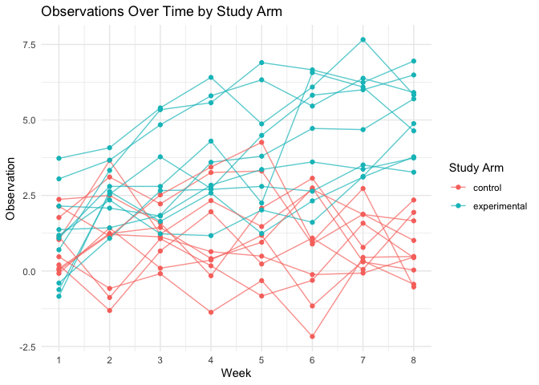

Homework 5
================
Ruichen Yang
2026-11-18

# Problem 1

``` r
birthday_sim = function(group_size) {
  birthdays = sample(1:365, size = group_size, replace = TRUE)
  any(duplicated(birthdays))
}
```

``` r
birthday_results = tibble(
  group_size = 2:50
) |>
  mutate(
    simulations = map(
      group_size,
      ~ replicate(10000, birthday_sim(.x))
    ),
    probability = map_dbl(simulations, mean)
  )

birthday_results
```

    ## # A tibble: 49 × 3
    ##    group_size simulations    probability
    ##         <int> <list>               <dbl>
    ##  1          2 <lgl [10,000]>      0.0023
    ##  2          3 <lgl [10,000]>      0.0083
    ##  3          4 <lgl [10,000]>      0.0169
    ##  4          5 <lgl [10,000]>      0.0268
    ##  5          6 <lgl [10,000]>      0.0379
    ##  6          7 <lgl [10,000]>      0.0575
    ##  7          8 <lgl [10,000]>      0.0752
    ##  8          9 <lgl [10,000]>      0.0916
    ##  9         10 <lgl [10,000]>      0.118 
    ## 10         11 <lgl [10,000]>      0.141 
    ## # ℹ 39 more rows

``` r
birthday_results |>
  ggplot(aes(x = group_size, y = probability)) +
  geom_line() +
  geom_point() +
  scale_y_continuous(labels = scales::percent_format()) +
  labs(
    x = "Group Size",
    y = "Probability of a Shared Birthday",
    title = "Probability of a Shared Birthday by Group Size"
  ) +
  theme_minimal()
```

<!-- -->

The probability that at least two people share a birthday increases
rapidly as group size increases. The simulated probability is
approximately 50% when the group size is around 23 people and continues
to rise toward 100% as the group becomes larger. This illustrates the
birthday paradox: a shared birthday becomes likely even in a group that
is much smaller than 365 people.

# Problem 2

``` r
file_names = list.files(
  path = "data",
  pattern = "\\.csv$",
  full.names = TRUE
)

file_names
```

    ##  [1] "data/con_01.csv" "data/con_02.csv" "data/con_03.csv" "data/con_04.csv"
    ##  [5] "data/con_05.csv" "data/con_06.csv" "data/con_07.csv" "data/con_08.csv"
    ##  [9] "data/con_09.csv" "data/con_10.csv" "data/exp_01.csv" "data/exp_02.csv"
    ## [13] "data/exp_03.csv" "data/exp_04.csv" "data/exp_05.csv" "data/exp_06.csv"
    ## [17] "data/exp_07.csv" "data/exp_08.csv" "data/exp_09.csv" "data/exp_10.csv"

``` r
study_data = tibble(
  file_name = file_names
) |>
  mutate(
    data = map(
      file_name,
      ~ read_csv(.x, show_col_types = FALSE)
    )
  )

study_data
```

    ## # A tibble: 20 × 2
    ##    file_name       data              
    ##    <chr>           <list>            
    ##  1 data/con_01.csv <spc_tbl_ [1 × 8]>
    ##  2 data/con_02.csv <spc_tbl_ [1 × 8]>
    ##  3 data/con_03.csv <spc_tbl_ [1 × 8]>
    ##  4 data/con_04.csv <spc_tbl_ [1 × 8]>
    ##  5 data/con_05.csv <spc_tbl_ [1 × 8]>
    ##  6 data/con_06.csv <spc_tbl_ [1 × 8]>
    ##  7 data/con_07.csv <spc_tbl_ [1 × 8]>
    ##  8 data/con_08.csv <spc_tbl_ [1 × 8]>
    ##  9 data/con_09.csv <spc_tbl_ [1 × 8]>
    ## 10 data/con_10.csv <spc_tbl_ [1 × 8]>
    ## 11 data/exp_01.csv <spc_tbl_ [1 × 8]>
    ## 12 data/exp_02.csv <spc_tbl_ [1 × 8]>
    ## 13 data/exp_03.csv <spc_tbl_ [1 × 8]>
    ## 14 data/exp_04.csv <spc_tbl_ [1 × 8]>
    ## 15 data/exp_05.csv <spc_tbl_ [1 × 8]>
    ## 16 data/exp_06.csv <spc_tbl_ [1 × 8]>
    ## 17 data/exp_07.csv <spc_tbl_ [1 × 8]>
    ## 18 data/exp_08.csv <spc_tbl_ [1 × 8]>
    ## 19 data/exp_09.csv <spc_tbl_ [1 × 8]>
    ## 20 data/exp_10.csv <spc_tbl_ [1 × 8]>

``` r
study_data = study_data |>
  mutate(
    arm = case_when(
      str_detect(file_name, "con_") ~ "control",
      str_detect(file_name, "exp_") ~ "experimental"
    ),
    subject_id = str_extract(file_name, "\\d{2}")
  )

study_data
```

    ## # A tibble: 20 × 4
    ##    file_name       data               arm          subject_id
    ##    <chr>           <list>             <chr>        <chr>     
    ##  1 data/con_01.csv <spc_tbl_ [1 × 8]> control      01        
    ##  2 data/con_02.csv <spc_tbl_ [1 × 8]> control      02        
    ##  3 data/con_03.csv <spc_tbl_ [1 × 8]> control      03        
    ##  4 data/con_04.csv <spc_tbl_ [1 × 8]> control      04        
    ##  5 data/con_05.csv <spc_tbl_ [1 × 8]> control      05        
    ##  6 data/con_06.csv <spc_tbl_ [1 × 8]> control      06        
    ##  7 data/con_07.csv <spc_tbl_ [1 × 8]> control      07        
    ##  8 data/con_08.csv <spc_tbl_ [1 × 8]> control      08        
    ##  9 data/con_09.csv <spc_tbl_ [1 × 8]> control      09        
    ## 10 data/con_10.csv <spc_tbl_ [1 × 8]> control      10        
    ## 11 data/exp_01.csv <spc_tbl_ [1 × 8]> experimental 01        
    ## 12 data/exp_02.csv <spc_tbl_ [1 × 8]> experimental 02        
    ## 13 data/exp_03.csv <spc_tbl_ [1 × 8]> experimental 03        
    ## 14 data/exp_04.csv <spc_tbl_ [1 × 8]> experimental 04        
    ## 15 data/exp_05.csv <spc_tbl_ [1 × 8]> experimental 05        
    ## 16 data/exp_06.csv <spc_tbl_ [1 × 8]> experimental 06        
    ## 17 data/exp_07.csv <spc_tbl_ [1 × 8]> experimental 07        
    ## 18 data/exp_08.csv <spc_tbl_ [1 × 8]> experimental 08        
    ## 19 data/exp_09.csv <spc_tbl_ [1 × 8]> experimental 09        
    ## 20 data/exp_10.csv <spc_tbl_ [1 × 8]> experimental 10

``` r
tidy_study = study_data |>
  unnest(data) |>
  pivot_longer(
    cols = starts_with("week_"),
    names_to = "week",
    values_to = "observation",
    names_prefix = "week_",
    names_transform = list(week = as.integer)
  ) |>
  select(arm, subject_id, week, observation)

tidy_study
```

    ## # A tibble: 160 × 4
    ##    arm     subject_id  week observation
    ##    <chr>   <chr>      <int>       <dbl>
    ##  1 control 01             1        0.2 
    ##  2 control 01             2       -1.31
    ##  3 control 01             3        0.66
    ##  4 control 01             4        1.96
    ##  5 control 01             5        0.23
    ##  6 control 01             6        1.09
    ##  7 control 01             7        0.05
    ##  8 control 01             8        1.94
    ##  9 control 02             1        1.13
    ## 10 control 02             2       -0.88
    ## # ℹ 150 more rows

``` r
tidy_study |>
  ggplot(
    aes(
      x = week,
      y = observation,
      group = interaction(arm, subject_id),
      color = arm
    )
  ) +
  geom_line(alpha = 0.7) +
  geom_point(size = 1.5) +
  scale_x_continuous(breaks = 1:8) +
  labs(
    x = "Week",
    y = "Observation",
    color = "Study Arm",
    title = "Observations Over Time by Study Arm"
  ) +
  theme_minimal()
```

<!-- -->

The control group remains relatively stable over the eight weeks, with
observations fluctuating around similar levels over time. In contrast,
the experimental group shows a clear upward trend, with observations
generally increasing as the study progresses. The difference between the
two groups becomes more pronounced in the later weeks, suggesting that
the experimental condition may be associated with increasing outcome
values over time.
