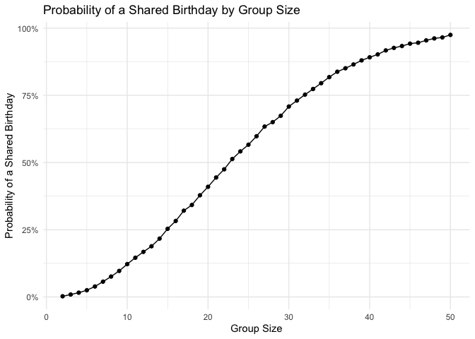

Homework 5
================
Ruichen Yang
2026-11-18

# Problem 1

``` r
birthday_sim = function(group_size) {
  birthdays = sample(1:365, size = group_size, replace = TRUE)
  any(duplicated(birthdays))
}
```

``` r
birthday_results = tibble(
  group_size = 2:50
) |>
  mutate(
    simulations = map(
      group_size,
      ~ replicate(10000, birthday_sim(.x))
    ),
    probability = map_dbl(simulations, mean)
  )

birthday_results
```

    ## # A tibble: 49 × 3
    ##    group_size simulations    probability
    ##         <int> <list>               <dbl>
    ##  1          2 <lgl [10,000]>      0.0024
    ##  2          3 <lgl [10,000]>      0.0089
    ##  3          4 <lgl [10,000]>      0.0158
    ##  4          5 <lgl [10,000]>      0.0249
    ##  5          6 <lgl [10,000]>      0.0388
    ##  6          7 <lgl [10,000]>      0.0568
    ##  7          8 <lgl [10,000]>      0.0758
    ##  8          9 <lgl [10,000]>      0.0967
    ##  9         10 <lgl [10,000]>      0.122 
    ## 10         11 <lgl [10,000]>      0.146 
    ## # ℹ 39 more rows

``` r
birthday_results |>
  ggplot(aes(x = group_size, y = probability)) +
  geom_line() +
  geom_point() +
  scale_y_continuous(labels = scales::percent_format()) +
  labs(
    x = "Group Size",
    y = "Probability of a Shared Birthday",
    title = "Probability of a Shared Birthday by Group Size"
  ) +
  theme_minimal()
```

<!-- -->

The probability that at least two people share a birthday increases
rapidly as group size increases. The simulated probability is
approximately 50% when the group size is around 23 people and continues
to rise toward 100% as the group becomes larger. This illustrates the
birthday paradox: a shared birthday becomes likely even in a group that
is much smaller than 365 people.
